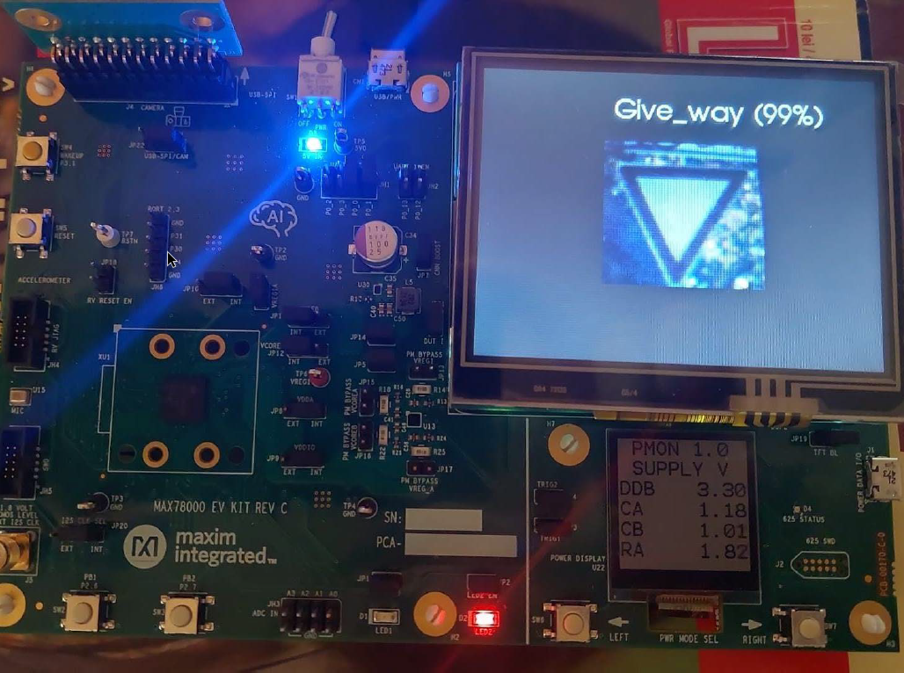
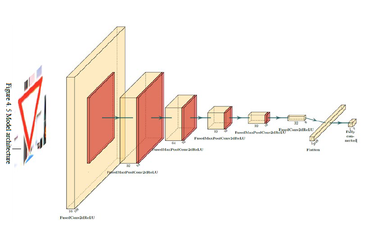
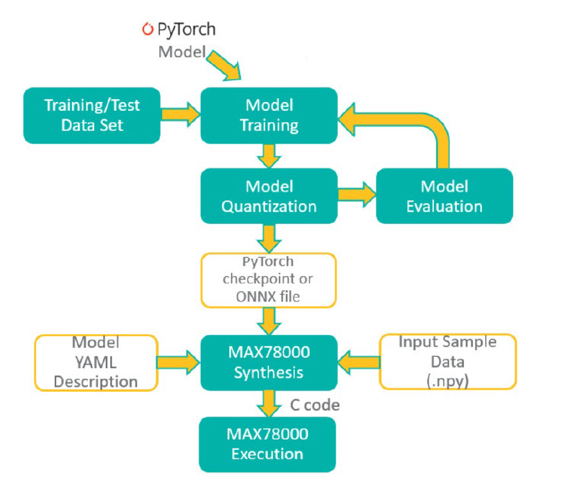

# Low-Power Road Sign Recognition

An embedded computer vision prototype that classifies road signs locally on a
MAX78000 evaluation board. The project explores the feasibility of running neural
networks on devices with limited energy, memory, and processing resources, without
requiring cloud connectivity.

## Functionality

The system recognizes three classes:

- **Give way** (`give_way`)
- **No entry** (`no_entry`)
- **Unknown** (`unknown`), intended for inputs outside the two target signs

During operation, the camera captures a 128 x 128 RGB image and transfers it into
RAM using DMA. The image is passed to the MAX78000 CNN accelerator for inference.
Softmax converts the model outputs into class probabilities, and the TFT display
shows the captured image and the most likely class. Results and inference timing
are also printed over UART.

The capture-and-classify cycle repeats continuously. To reduce power consumption,
the Arm Cortex-M4 waits in sleep mode while the accelerator processes the image,
and the CNN is stopped after inference.

*Live recognition on the board: the TFT shows the camera image and a give-way
prediction at 99% confidence, not a measure of overall model accuracy.*

## Model and Development Workflow

The thesis uses a seven-layer `ai85cdnet` model with a three-channel, 128 x 128
input and three classification outputs. Training uses images from the German
Traffic Sign Recognition Benchmark (GTSRB), with augmentation to introduce noise,
color changes, and geometric variation.

*Model architecture: convolutional feature extraction and spatial downsampling,
followed by flattening and a fully connected classification layer.*

The workflow uses PyTorch and Analog Devices' `ai8x-training` and `ai8x-synthesis`
tools: train with quantization-aware training, quantize to 8-bit weights, evaluate,
generate C code, then build and flash the firmware using the Maxim SDK toolchain.

*Development workflow: evaluation feeds back into training; synthesis combines the
model checkpoint, hardware YAML description, and sample input to generate C code.*

## Reported Results and Limitations

The thesis reports approximately **12 ms per inference** and **56 ms per complete
cycle**. Model weights occupy **57,776 bytes**, or **13.1% of CNN weight memory**.
These are results from the thesis setup, not guaranteed performance on every build.

Real-world accuracy is sensitive to lighting and dataset diversity. In particular,
some unknown inputs are misclassified as no-entry signs, and quantization can
reduce accuracy. This is a feasibility prototype, not a safety-certified road sign
recognition system.

## Repository Contents

- [model_training/](model_training/): dataset loader and training/synthesis configuration files.
- [uC code/](uC%20code/): embedded C firmware, generated CNN code and weights, and display assets.
- [docs/cnn_sign_recognition.pdf](docs/cnn_sign_recognition.pdf): full master's thesis, including methodology and experimental results.

Based on *Feasibility study on the use of neural network algorithms in systems with
energy and processing constraints*, by Alexandru Jutra, supervised by Prof. George
Dan Mois, Technical University of Cluj-Napoca, July 2025.